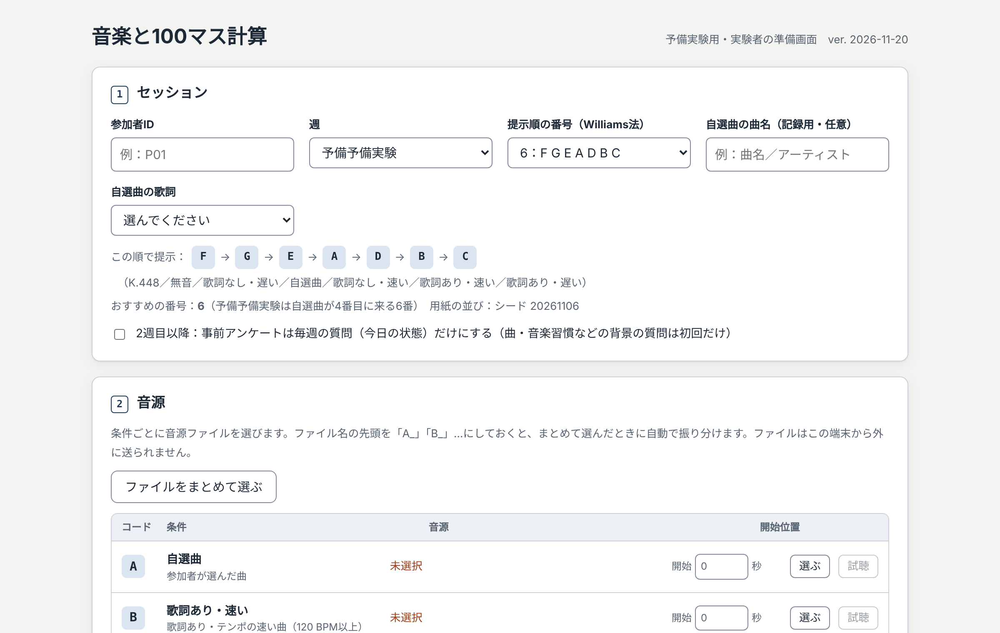

# 音楽と100マス計算：音楽を聴きながら行う作業実験アプリ

音楽を聴きながら100マス計算に取り組んでもらい、**曲の条件ごとに、作業の成績と気分の変化を記録する**ための、ブラウザで動く実験用アプリです。
修士研究「自分で選んだ好きな曲と、実験者が選んだ曲で、作業の成績や気分がどう変わるか」のために、設計から実装まで一人で行いました。

> **English summary**
> A single-file web app for a within-subject experiment on music and mental arithmetic.
> It runs seven listening conditions in a Williams-design order, presents difficulty-matched 2-digit × 1-digit multiplication grids, equalizes loudness of the music files (ITU-R BS.1770, implemented in the browser), collects mood ratings (Affect Grid) before and after each condition, and exports trial-level data (responses, accuracy, reaction times in ms, timestamped events) as a ZIP of CSV files — with no external libraries.

**デモ**：https://（GitHubのユーザー名）.github.io/music-100masu/

---

## なぜ作ったのか

音楽が作業に与える影響を正しく比べるには、曲以外の条件をそろえる必要があります。

- **問題の難しさ**：条件ごとに問題がやさしくなったり難しくなったりすると、曲の効果と区別できません。
- **音の大きさ**：曲によって音量が違うと、それだけで成績や気分が変わってしまいます。
- **順番**：最初の条件ほど慣れていない、後の条件ほど疲れている、という順番の影響があります。

音楽の再生、計算課題、気分のアンケート、データの記録を一つの流れにまとめ、これらの条件をそろえたまま実施できるように自作しました。

## 主な機能

- **7つの条件**：自選曲／歌詞あり・速い曲／歌詞あり・遅い曲／歌詞なし・速い曲／歌詞なし・遅い曲／モーツァルトK.448／無音
- **提示順の割り当て**：Williams法（7条件・14通り）で順番を決め、参加者番号と週からおすすめの順番を提案します。
- **100マス計算**：2けた×1けたのかけ算（10行×8列＝80問）。どの表も同じ80問で、並びだけを乱数で変えます。乱数のシードを固定しているので、同じ表を再現できます。
- **1条件の流れ**：安静 → 曲が流れ始めて30秒後に計算開始 → 曲を聴きながら120秒計算（時間は設定で変更できます）。
- **音の大きさをそろえる**：ITU-R BS.1770（ラウドネス）の計算をブラウザ上で実装し、読み込んだ曲の音の大きさを自動でそろえます。
- **気分と印象の測定**：各条件の前後に Affect Grid（快・覚醒の2軸）で気分を、終了後に曲の印象（好き・聴き慣れ・集中できたか・疲れなど）を回答してもらいます。
- **記録と保存**：1問ごとの回答・正誤・反応時間（ミリ秒）、出来事の時刻などを記録し、ZIP（CSV 5種＋JSON）で保存します。ZIPの作成も外部ライブラリなしで実装しています。
- **データを失わない工夫**：ブラウザ内に自動で保存し、途中でも保存できます。入力モード（IME）の警告や、画面から離れた回数も記録します。
- **テストモード**：短い時間で、全体の流れを一通り確認できます。

## 使い方

1. `index.html` を Google Chrome で開きます。
2. 参加者ID・週・提示順の番号を選びます。
3. 条件ごとに音源ファイルを選びます。ファイル名の先頭を「A_」「B_」…にしておくと、まとめて選んだときに自動で振り分けます。音源はこの端末の中で読み込むだけで、外部には送られません。
4. 開始すると参加者向けの画面に切り替わり、練習 → 本番の順に進みます。
5. 終了画面から、記録をZIPで保存します。

## 出力されるデータ

| ファイル | 中身 |
|---|---|
| `_trials.csv` | 1問ごとの問題・回答・正誤・反応時間（ミリ秒） |
| `_summary.csv` | 条件ごとの正答数・正答率・1分あたりの正答数、気分の変化、曲の印象など |
| `_events.csv` | 開始・終了・音楽の再生など、出来事の時刻 |
| `_questionnaire.csv` | 事前・事後アンケートの回答 |
| `_session.csv` | 設定、提示順、使用した音源、端末の情報 |
| `_raw.json` | すべての記録をそのまま保存したもの |

## 工夫した点

- **難しさをそろえた問題**：左に並ぶ10個の2けたの数は、十の位の1〜9と一の位の0〜9が1回ずつ出る組み合わせにしました。上の数は2〜9で、答えがすぐ分かる×0と×1は入れていません。
- **音の大きさを数字でそろえる**：音量を耳で合わせるのではなく、ラウドネス（LUFS）を計算して自動でそろえるようにしました。
- **順番の影響を打ち消す**：Williams法で、どの条件も同じ回数ずつ、いろいろな位置に来るようにしました。
- **実験の失敗を防ぐ**：開始前に、参加者IDや音源の長さが足りているかを自動でチェックします。

## 使っている技術

HTML / CSS / JavaScript（外部ライブラリなし）、Web Audio API、localStorage
※フォントは Google Fonts を使っています（オフラインのときは端末のフォントで表示されます）。

## データ・音源について

このリポジトリには、**実験参加者のデータや音源ファイルは一切含まれていません**。実験で使った具体的な曲名も載せていません。

## ライセンス

MIT License（詳しくは [LICENSE](LICENSE) をご覧ください）
